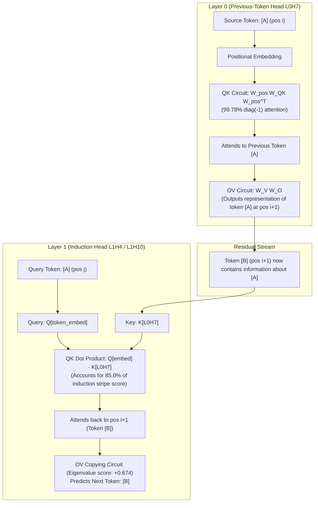

# TransformerLens Circuits: Reverse-Engineering Induction & In-Context Learning in LLMs

[](https://www.python.org/downloads/)
[](https://pytorch.org/)
[](https://github.com/TransformerLensOrg/TransformerLens)
[](tests/)
[](LICENSE)

An end-to-end mechanistic interpretability research suite reverse-engineering **in-context learning (ICL)** and **induction circuits** in autoregressive Transformers (GPT-2 Small and a 2-layer Attention-Only Transformer) from first principles.

Built on the mathematical foundations of the [Anthropic Transformer Circuits Framework](https://transformer-circuits.pub/2021/framework/index.html) (Elhage et al., 2021) and [In-context Learning and Induction Heads](https://transformer-circuits.pub/2022/in-context-heads/index.html) (Olsson et al., 2022), this repository rigorously decomposes attention heads into independent **Query-Key (QK)** and **Output-Value (OV)** circuits, validating them via **weight-level linear algebra**, **causal activation patching**, and **loss-degradation ablation**.

---

## Key Empirical Findings & Quantitative Metrics

| Mechanistic Property | Target Head / Circuit | Model | Empirical Result / Metric | Baseline / Comparison |
| :--- | :--- | :--- | :--- | :--- |
| **Previous-Token QK Circuit** | L0H7 | 2L Attn-Only | **99.78%** mean attention on $\text{diag}(-1)$ | Full 2,048 context window ($<6.1\times 10^{-4}$ assoc. error) |
| **Causal NLL Loss Surge** | L0H7 | 2L Attn-Only | **+8.112** NLL loss increase on repeated tokens | Rank #1 of 24 heads (induction heads: L1H10 +5.604, L1H4 +2.030) |
| **Targeted Activation Patching** | L0H7 $\to$ L1H4 | 2L Attn-Only | **0.5659 $\to$ 0.0030** induction score (**99.47% collapse**) | All other layer-0 heads have negligible delta ($\Delta < 0.03$) |
| **Bilinear QK Decomposition** | $Q[\text{embed}] \cdot K[\text{L0H7}]$ | 2L Attn-Only | **+5.757** out of +6.775 total stripe score (**85.0%**) | Exact bilinear reconstruction down to $0.00 \times 10^0$ error |
| **Low-Rank K-Composition** | L0H7 $\to$ L1H4 / L1H10 | 2L Attn-Only | **0.11210 / 0.11195** Frobenius alignment | **3.11$\times$ above random baseline** ($1/\sqrt{d_{model}} = 0.0361$) |
| **Induction Stripe Score** | L7H10 | GPT-2 Small | **0.9426** mean attention along induction stripe | Rank #1 of 144 heads (at query 51, attends key 2 with prob 0.785) |
| **Positive Eigenvalue Copying** | L7H10 / L11H3 | GPT-2 Small | **0.6739** (L7H10), up to **0.9995** (L11H3) | Computed over $64\times 64$ Gram map (avoids $50\text{k}\times 50\text{k}$ vocab matrix) |
| **Direct Logit Attribution** | L10H5 | GPT-2 Small | **+0.7725** logit contribution to `' sat'` (total 16.61) | Zero error ($0.000\times 10^0$) vs full model residual reference |

---

## Circuit Architecture



---

## Theoretical Overview & Methodologies

### 1. The QK and OV Circuit Decomposition
In autoregressive Transformers without non-linearities between attention layers (or when analyzing components in isolation), each attention head can be decomposed into two independent bilinear operators:
- **QK Circuit ($W_{QK} = W_Q W_K^T$)**: Computes *where* the head attends as a function of queries and keys.
- **OV Circuit ($W_{OV} = W_V W_O$)**: Determines *what* information is moved and how it affects the residual stream and logits.

### 2. Weight-Level Previous-Token Heads
For Layer 0, shortformer positional embeddings interact directly through $W_{QK}$:
$$\text{Scores}_{pos} = W_{pos} W_{QK} W_{pos}^T$$
Applying causal masking and $\text{Softmax}(\cdot / \sqrt{d_{head}})$ demonstrates that **L0H7** has **99.78%** of its attention mass concentrated on $\text{diag}(-1)$.

### 3. Low-Rank Positive Eigenvalue Copying Metric
Full token-to-token OV mapping involves $M = W_E W_V W_O W_U \in \mathbb{R}^{d_{vocab} \times d_{vocab}}$ ($50,257 \times 50,257$), which is computationally intractable to materialize. Using the cyclic commutativity identity of non-zero eigenvalues ($\text{spec}(AB) = \text{spec}(BA)$), we construct the compressed $d_{head} \times d_{head} = 64 \times 64$ operator:
$$M_{small} = W_O W_U W_E W_V \in \mathbb{R}^{64 \times 64}$$
The formal copying statistic is positive eigenvalue mass:
$$\text{Score}_{copying} = \frac{\sum_i \text{Re}(\lambda_i)}{\sum_i |\lambda_i|}$$

### 4. Low-Rank K-Composition
Induction heads read earlier heads' outputs through their key projections. K-composition measures the Frobenius alignment between head $A$'s OV circuit and head $B$'s QK circuit:
$$\text{comp}(A, B) = \frac{\| W_{OV}^A (W_{QK}^B)^T \|_F}{\| W_{OV}^A \|_F \| W_{QK}^B \|_F}$$
To scan all 144 pairs efficiently on CPU, this repository computes Frobenius norms using $d_{head} \times d_{head}$ Gram matrices:
$$\| V O \|_F^2 = \text{Tr}((V^T V)(O O^T)), \quad \| Q K^T \|_F^2 = \text{Tr}((Q^T Q)(K^T K))$$
$$\| (V O)(Q K^T)^T \|_F^2 = \text{Tr}((L^T L)(Q^T Q)), \quad \text{where } L = V (O K)$$

### 5. Causal Ablation & Targeted Activation Patching
- **Zero Ablation ($hook\_z$)**: Replaces a head's output activations with zeros. On 50-token repeated sequences $[BOS, X_{1..50}, X_{1..50}]$, ablating L0H7 causes an NLL surge of **+8.112** (compared to $<0.5$ for non-circuit heads).
- **Targeted Activation Patching ($hook\_v$)**: Zeroing L0H7's $V$ activations drops L1H4's induction stripe score from **0.56594 to 0.00302** (**99.47% reduction**), demonstrating strict causal dependency.

---

## Repository Structure

```text
arena 1.2/
├── .gitignore                                      # Standard git ignore rules
├── requirements.txt                                # Minimal reproducible dependencies
├── README.md                                       # Comprehensive documentation & benchmarks
├── run_benchmarks.py                               # Unified CLI benchmark runner
├── results/
│   └── benchmark_metrics.json                      # Machine-readable quantitative outputs
├── tests/
│   └── test_circuits.py                            # Pytest suite verifying synthetic & numerical tests
│
├── # Foundation & Exploration Scripts
├── arena_1_2_transformerlens_01_model_inspection.py
├── arena_1_2_transformerlens_02_tokenize_and_forward.py
├── arena_1_2_transformerlens_03_activation_cache.py
├── arena_1_2_transformerlens_04_head_behavior_detectors.py
│
├── # Induction Pattern & Copying Circuits
├── arena_1_2_transformerlens_05_repeated_tokens_induction_setup.py
├── arena_1_2_transformerlens_06_induction_score.py
├── arena_1_2_transformerlens_07_inspect_induction_head.py
├── arena_1_2_transformerlens_08_induction_score_with_hooks.py
├── arena_1_2_transformerlens_09_targeted_ablation_composition.py
├── arena_1_2_transformerlens_10_ov_copying_circuit.py
├── arena_1_2_transformerlens_10b_copying_eigenvalue_score.py
├── arena_1_2_transformerlens_11_k_composition.py
│
├── # Observational Attribution & Logit Lenses
├── arena_1_2_transformerlens_12_direct_logit_attribution.py
├── arena_1_2_transformerlens_13a_exact_single_ov.py
├── arena_1_2_transformerlens_13b_combined_ov_exact_v2.py
│
└── # Causal Ablation & Rigorous Circuit Decompositions
    ├── arena_1_2_transformerlens_14_qk_prev_token_circuit_fixed.py
    ├── arena_1_2_transformerlens_15_canonical_induction_patterns.py
    ├── arena_1_2_transformerlens_16_canonical_induction_ablation.py
    ├── arena_1_2_transformerlens_17_canonical_mean_ablation.py
    ├── arena_1_2_transformerlens_18_targeted_ablation.py
    ├── arena_1_2_transformerlens_19_qk_component_decomposition.py
    └── arena_1_2_transformerlens_20_canonical_k_composition.py
```

---

## Quickstart & Reproduction

### 1. Installation
Clone the repository and set up a virtual environment:
```bash
git clone https://github.com/PranavBansal7/transformer-circuits-interpretability.git
cd transformer-circuits-interpretability

conda create -n arena-env python=3.11 -y
conda activate arena-env
pip install -r requirements.txt
```

### 2. Run the Unit & Regression Test Suite
Run the full test suite verifying numerical linear algebra identities, low-rank Gram matrices, and ablation hooks:
```bash
pytest tests/ -v
```

### 3. Run Benchmark Suite & Generate Metrics
Execute the unified benchmark pipeline to reproduce all key empirical findings:
```bash
python run_benchmarks.py --save
```
Results will be output to console and saved as JSON in `results/benchmark_metrics.json`.

---

## References & Acknowledgments
- **A Mathematical Framework for Transformer Circuits** (Elhage et al., Anthropic, 2021)
- **In-context Learning and Induction Heads** (Olsson et al., Anthropic, 2022)
- **TransformerLens** (Neel Nanda and Joseph Bloom, 2022)
- **ARENA: Alignment Research Engineer Accelerator** (Callum McDougall, ARENA 3.0)

---
**Author**: [Pranav Bansal](https://github.com/PranavBansal7)
