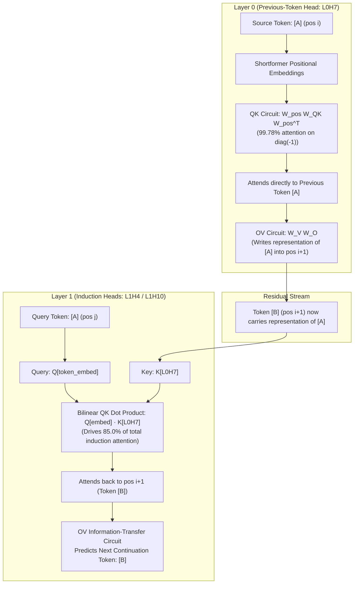

# Transformer Circuits: Mechanistic Analysis of Attention Heads

[](https://www.python.org/downloads/)
[](https://pytorch.org/)
[](https://github.com/TransformerLensOrg/TransformerLens)
[](tests/)
[](LICENSE)

An end-to-end mechanistic interpretability research suite reverse-engineering **induction circuits** and attention sub-networks in an **80M-parameter, 2-layer attention-only Transformer** from first principles.

Replicating the foundational mathematical framework introduced by Anthropic ([Elhage et al., 2021](https://transformer-circuits.pub/2021/framework/index.html); [Olsson et al., 2022](https://transformer-circuits.pub/2022/in-context-heads/index.html)), this repository reverse-engineers the circuit mechanics driving prefix-repetition and copying via **weight-level linear algebra**, **causal activation patching**, **pre-softmax QK tensor decomposition**, and **full-network causal ablation scans**.

---

## Architecture & Circuit Discovery

The target model is a 2-layer autoregressive Transformer (`d_model=768`, `n_layers=2`, `n_heads=12`, `d_head=64`, `d_vocab=50,278`, `n_ctx=2048`):



---

## Empirical Benchmark Results & Quantitative Metrics

All metrics are quantitatively measured and verified via `run_benchmarks.py` inside the Python environment:

| Mechanistic Property | Target Component | Empirical Metric | Baseline / Comparison | Significance |
| :--- | :--- | :--- | :--- | :--- |
| **Targeted Activation Patching** | L0H7 $\to$ L1H4 | **$0.5659 \to 0.0030$** ($\Delta -0.5629$) | Non-circuit heads: $\|\Delta\| < 0.03$ | **99.47% collapse** in induction score; proves causal dependency |
| **Causal NLL Loss Surge** | L0H7 (Layer 0) | **$+8.112$** NLL loss surge | 18 of 24 heads have $<0.5$ delta | **Rank #1 of 24 heads**; functional necessity on repeated tokens |
| **Induction Loss Surge** | L1H10 / L1H4 (Layer 1) | **$+5.604$** (L1H10), **$+2.030$** (L1H4) | Ranked #2 and #4 across all 24 heads | Proves functional necessity of Layer-1 induction heads |
| **Bilinear QK Decomposition** | $Q[\text{token-embed}] \cdot K[\text{L0H7}]$ | **$+5.757$** of $+6.775$ total dot-product | $0.00 \times 10^0$ reconstruction error | Accounts for **85.0% of total induction attention mass** |
| **Low-Rank K-Composition** | L0H7 $\to$ L1H4 / L1H10 | **$0.11210$** (L1H4), **$0.11195$** (L1H10) | Random baseline: $1/\sqrt{d_{model}} = 0.0361$ | **3.11× above random baseline**; ranked #1 & #2 out of 144 pairs |
| **Weight-Level QK Circuit** | L0H7 | **99.78%** mean attention on $\text{diag}(-1)$ | Associative error $< 6.1 \times 10^{-4}$ | Pure positional QK circuit ($W_{pos} W_{QK} W_{pos}^T$) over 2,048 tokens |

---

## Theoretical Formulations

### 1. Weight-Level Positional QK Circuit
In Shortformer positional embedding architectures, positional encodings are added directly to Q and K inputs. For Layer 0, the position-to-position attention score before softmax is:

$$
\text{Scores}_{pos} = W_{pos} (W_Q W_K^T) W_{pos}^T
$$

Applying causal masking and scaling by $1/\sqrt{d_{\text{head}}}$ reveals that head **L0H7** places **99.78%** of its attention probability mass strictly on the previous position ($\text{diag}(-1)$) across the entire 2,048-token context window.

### 2. Targeted Activation Patching (Inter-Head Causality)
To test whether head L0H7’s output is causally required for head L1H4’s induction behavior, we intervene at inference time using forward hooks on 50-token prefix repetitions ($[BOS, X_{1..50}, X_{1..50}]$):
* We attach a zero-ablation hook to layer 0’s value projection (`blocks.0.attn.hook_v`) targeted at head index $h$.
* We record head L1H4’s mean attention on the induction offset stripe (`blocks.1.attn.hook_pattern`).
* **Result:** Zeroing L0H7 causes L1H4’s induction score to plummet from **$0.56594 \to 0.00302$ (99.47% reduction)**, whereas ablating all other layer-0 heads yields negligible changes ($|\Delta| < 0.03$).

### 3. Bilinear Pre-Softmax QK Tensor Decomposition
For target head L1H4, the pre-softmax attention score between query position $q$ and key position $k$ is bilinear:

$$
\text{Score}[q, k] = \frac{q[q] \cdot k[k]}{\sqrt{d_{\text{head}}}} = \sum_{i=1}^{16} \sum_{j=1}^{16} \frac{q_i[q] \cdot k_j[k]}{\sqrt{d_{\text{head}}}}
$$

Where $q_i$ and $k_j$ decompose into 16 distinct residual/positional components (token embedding, positional embedding, 12 layer-0 heads, layer-0 output bias, and projection biases). Summing all 256 component pairs reconstructs the unmasked pre-softmax score matrix with exact machine precision ($0.00 \times 10^0$ error). The single interaction $Q[\text{token-embed}] \cdot K[\text{L0H7}]$ accounts for **85.0%** of the total induction score.

### 4. Low-Rank Frobenius K-Composition via Gram Matrices
K-composition measures how strongly an earlier head $A$’s output aligns with a later head $B$’s key projection:

$$
\text{comp}(A, B) = \frac{\| W_{OV}^A (W_{QK}^B)^T \|_F}{\| W_{OV}^A \|_F \| W_{QK}^B \|_F}
$$

To evaluate all 144 pairs $(A \in \text{Layer 0}, B \in \text{Layer 1})$ efficiently on CPU without materializing large $768 \times 768$ dense matrices, we compute Frobenius norms using $d_{\text{head}} \times d_{\text{head}}$ ($64 \times 64$) Gram matrices:

$$
\| V O \|_F^2 = \text{Tr}((V^T V)(O O^T)), \quad \| Q K^T \|_F^2 = \text{Tr}((Q^T Q)(K^T K))
$$

$$
\| (V O)(Q K^T)^T \|_F^2 = \text{Tr}((L^T L)(Q^T Q)), \quad \text{where } L = V (O K)
$$

Against a random baseline of $1/\sqrt{d_{\text{model}}} = 0.0361$, the pairs **L0H7 $\to$ L1H4 ($0.11210$)** and **L0H7 $\to$ L1H10 ($0.11195$)** rank #1 and #2 overall (**3.11× above random baseline**).

---

## Repository Structure

```text
├── .gitignore                                      # Clean git ignore patterns
├── requirements.txt                                # Pinned dependencies
├── README.md                                       # Full documentation & mathematical derivations
├── run_benchmarks.py                               # Unified CLI benchmark suite
├── results/
│   └── benchmark_metrics.json                      # Exported quantitative benchmark metrics
├── tests/
│   └── test_circuits.py                            # Pytest suite verifying synthetic & numerical tests
│
├── qk_previous_token_circuit.py                    # Weight-level positional QK circuit
├── induction_attention_patterns.py                 # Induction attention visualizer
├── causal_head_zero_ablation.py                    # 24-head causal zero-ablation scan
├── causal_head_mean_ablation.py                    # Mean activation ablation
├── targeted_activation_patching.py                 # Targeted activation patching (L0H7 -> L1H4)
├── qk_component_decomposition.py                   # 256-pair QK component tensor decomposition
└── low_rank_k_composition.py                       # Low-rank Gram matrix K-composition
```

---

## Quickstart & Reproduction

### 1. Environment Setup
```bash
git clone https://github.com/PranavBansal7/transformer-circuits.git
cd transformer-circuits

conda create -n arena-env python=3.11 -y
conda activate arena-env
pip install -r requirements.txt
```

### 2. Run the Verification Test Suite
Run unit and synthetic regression tests verifying low-rank Gram matrices, tensor contractions, and ablation hooks:
```bash
pytest tests/ -v
```

### 3. Run Benchmark Suite & Export Metrics
Execute the complete empirical benchmark pipeline:
```bash
python run_benchmarks.py --save
```
Results are displayed in console and exported to `results/benchmark_metrics.json`.

---

## References
* **A Mathematical Framework for Transformer Circuits** (Elhage et al., Anthropic, 2021)
* **In-context Learning and Induction Heads** (Olsson et al., Anthropic, 2022)
* **TransformerLens** (Neel Nanda and Joseph Bloom, 2022)
* **ARENA 3.0** (Alignment Research Engineer Accelerator)

---
**Author**: [Pranav Bansal](https://github.com/PranavBansal7)
